# Goal

Made by Vibe Coders for Vibe Coders to prepare the way of the Lord and make His paths straight. 

**Isaiah 40:3 “...Prepare the way for the LORD in the wilderness; make a straight highway for our God in the desert."**

## Bottom line up front

- **Why:** To Bless the Nations

- **Great Commission:** dx-maps exists to give disciples, churches and leaders what they need to bless the
  nations. We believe the deeper answer to the Great Commission is indigenous disciples, churches
  and leaders multiplying among their own peoples and blessing them, so that the Commission is
  fulfilled through love. The maps serve that in three ways: praying for the unreached peoples of
  the world, mobilising believers to bless their own neighbours and cities, and caring for the needy
  with private maps that stay with the people who serve them.
- **How it was made:** no human wrote this code. It is about 100% AI-coded, and about 90% of the
  maps began as a vision spoken aloud (voice-to-text, such as Rudder) and handed to an AI agent that
  built it with dx-maps. If you can picture a map and say it in plain English, an agent can build it.
- **Who it's for:** vibe coders, people who build by describing what they want to an AI agent. One
  repo, one shared library and a live Plugin Studio let your agents build many maps side by side
  ([what you get](#vibe-coders--who-dx-maps-was-built-for)).
- **Our favorite:** the experimental Gospel × Internet dashboard: the most experimental, and likely
  the most impactful for the Great Commission, because everything comes together there.
  It is inspired by the Perspectives course and book, and by Curtis Sergeant's 100-list and
  relational-stewardship training (bounded and centered sets).
- **What each map is for:**
  - **Big Picture:** the library's own interface, the one agents use to build maps.
  - **UPG100 List:** the most strategic. It divides the task into prayer packets.
  - **Gospel maps:** the resources that exist in each language.
  - **UPG Neighbor:** the reached neighbors near each unreached group.
  - **Gospel × Internet:** all of it, together. Built for linguists, catalysts, translators (human
    and AI) and prayer warriors.

Built with love, with the prayer that these maps bless the nations.

**A blessing for you.** These maps and posters are given to bless the people who bless the nations.
We love you, and we are thankful for your work. We bless you in Jesus' name.

Posterverse (`plugin-designs/posterverse/`) brings the six poster plugins together: UPG100 Posters, Country
Posters, Poster Design, Wall of People Groups, Bible Posters and Bless India Posters. They are all in the
Plugin Studio (`bun run dev`) too.

# dx-maps — one build, maps that embed everywhere

**Write a map once in `plugin-designs/<your-map>/`, run one build, and drop it on any site** —
iframe, script embed, mobile app — or open every map at once as one app. Five plugin
capabilities, three outputs, one shared library, one build.

> **Using an AI agent?** Give it [`skills/plugin-designer`](./skills/plugin-designer). It learns
> this framework's terms and patterns, which lowers the barrier to entry.

### What the library gives every map

| | |
|---|---|
| 🗺️ **Two map engines** | Every map draws with **Mapbox** or **MapLibre** (free, no key) — switch with `"provider"` in its settings or `?provider=mapbox` in the address. By default it uses MapLibre; Mapbox is an explicit choice (`"provider": "mapbox"` and a token). |
| 🔑 **A key or a key service** | Give Mapbox a public token, or the address of a token service that hands one out — set once in the Plugin Studio header. |
| 🌍 **11 languages** | `?lang=` or `"locale"`, with Arabic right to left — [Languages](#languages). |
| 🧩 **Web components** | Each map is its own HTML tag, like `<all-people-groups>`, that works on any page — no framework needed. |
| 🔗 **Maps that talk to each other** | Maps share props and events, so one app can nest them and a click in one can move another. |
| 🪶 **Small bundles** | Each map's file carries only the parts of the shared library it uses (tree-shaken). |
| ⚙️ **One build step** | `bun run build` makes every map at once. |
| 📦 **Three outputs** | A web folder (iframe, script embed), a mobile app, and a desktop app built from the same code you run in the browser — [the 3 outputs](#what-the-build-makes--3-outputs). |

| What dx-maps set out to do | Proof |
|---|---|
| **One build → one folder** you can drop on any host | `bun run check:drop` |
| **Every map embeddable** from a copy-paste snippet | [the 3 outputs](#what-the-build-makes--3-outputs) · `bun run check:embed-targets` |
| **Every map interoperable** through props and events | `bun run verify:interop` |
| **One app nests every map** — and each stays embeddable on its own | [capability 5](#capability-5--app-shell-the-research-gallery) · `bun run check:composite-reg` |
| **5 capabilities, every one shippable in every output** | `bun run verify:5-caps` |
| **Shared library, private plugins** — reuse without breaking each other | `bun run check:library-index` |
| **One agent per plugin, the repo agent reads every change, one merge at a time** | [agent swarm](#build-it-with-an-agent-swarm) |

## For vibe coders: build, open the Studio, embed a map

**1. Open the Plugin Studio** (every map, live, updating as you or your agent edit):

```bash
bun install --frozen-lockfile
bun run dev                     # open the address it prints: that page is the Plugin Studio
```

**2. Build.** The built maps are already in the repo. After a change, rebuild just that map, or all of them:

```bash
BUNDLE=<map> bun x vite build && bun run tree && bun run fix:sri   # one map, then its pages and hashes
BUILD_ALLOW=1 bun run build                                         # every map (~4 min); the output is public/dx-maps/
```

After a one-map build, `bun run tree` rewrites the map's pages and the manifest (a changed `.meta.json` reaches
them only this way), and `fix:sri` refreshes their integrity hashes. Skip them and the map's own page and any pasted
snippet keep the old settings and refuse the new file. When the DX Life site's repo sits next to this one (`../doxa-life`), the full build also copies the maps into
its `public/`. That is the one path set in `vite.doxa-maps-build-config.json` (`dropin.dest`); nothing else on
your computer is searched. No site there: the step says so and skips. `DOXA_DROPIN=off` turns it off, and
`bun run dropin` copies on demand.

**3. Embed a map.** Every map has its own embed script: its `embed.script` in `public/dx-maps/manifest.json` (an
`embed.iframe` too). Paste it whole. It preloads the map engine, points the map at its data
(`window.MAP_APP_API_URL`), loads the map's script with its integrity hash, and places the map's tag. The two
lines at its core:

```html
<script src="/dx-maps/doxa-simple-map/doxa-simple-map.js" integrity="sha384-…" crossorigin="anonymous"></script>
<doxa-map profile-config='{"profile":"doxa-simple-map","assetsBase":"/dx-maps/assets"}'></doxa-map>
```

On DX Life, the maps are served from its own `public/dx-maps/`, so a page loads `/dx-maps/<map>/<map>.js` and
places the map's tag. Copy each snippet from the manifest: its `integrity` hash changes with every build. More:
[the three routes](#where-the-folder-goes-three-routes) and [how a page shows a map](#how-a-page-shows-a-map).

## For agents: what this repo is for

This repo builds **mobilization maps**: maps that help disciples, churches and leaders reach their city and the
people groups of the world. When you work here, the goal is one of these:

| Goal | The production maps that serve it |
|---|---|
| **Reach a city** | Regions (`regions-dashboard`) and the country map (`country-map`): the people groups of each country. The production maps work by country and region; city-level planning (Prayer Walk Planner) is still experimental |
| **Mobilize for people groups** | Big Picture (`dashboard-plus-grid`); Simple Research (`research-map-plus-grid`) |
| **Plan outreach** | Gospel Resources (`gospel-resources`): what exists in each language; Cities with Internet (`cities-internet`): whether a group can be reached online |
| **Pray: packets and prayer resources** | UPG100 Posters (`my-upg-100-list`), Regions and Simple Research: posters and prayer packets; Prayer Progress (`doxa-simple-map`) |

- **Start with the skill:** [`skills/plugin-designer`](./skills/plugin-designer) teaches the patterns, the shared
  library and the checks.
- **One plugin per folder** in `plugin-designs/`; shared code goes in `library/` only if it stays reusable for
  every other plugin.
- **Join `development`** (the pilot), one change at a time through the lock, with `gates:pre`, `gates:post` and the landing checks passing. `main` is
  production and moves only on a publish.
- These 8 maps are in production: the 7 production maps in the gallery, plus the country map for DX Life's country pages. The
  other maps are experimental: leave them as they are unless your task is one
  of them.

*Click any ▸ to read more. Everything below is folded so you can scroll the pictures first.*

---

## The production maps

**Seven production maps DX uses today, all together in the Research Gallery**, which DX Life publishes
as **Deep Research**; each one is also a plugin you can embed on its own. The gallery also carries two
poster plugins still marked experimental, Country Posters and Poster Design (see Posterverse). An eighth
production map, the country map (`country-map`), draws DX Life's country pages; it isn't in the gallery.

<table>
<tr>
<td width="25%" valign="top"><br><b>Big Picture</b><br><sub>the whole research dashboard: filters, map, charts, people groups</sub></td>
<td width="25%" valign="top"><br><b>Simple Research</b><br><sub>the research map with the people-groups grid, made for phones</sub></td>
<td width="25%" valign="top">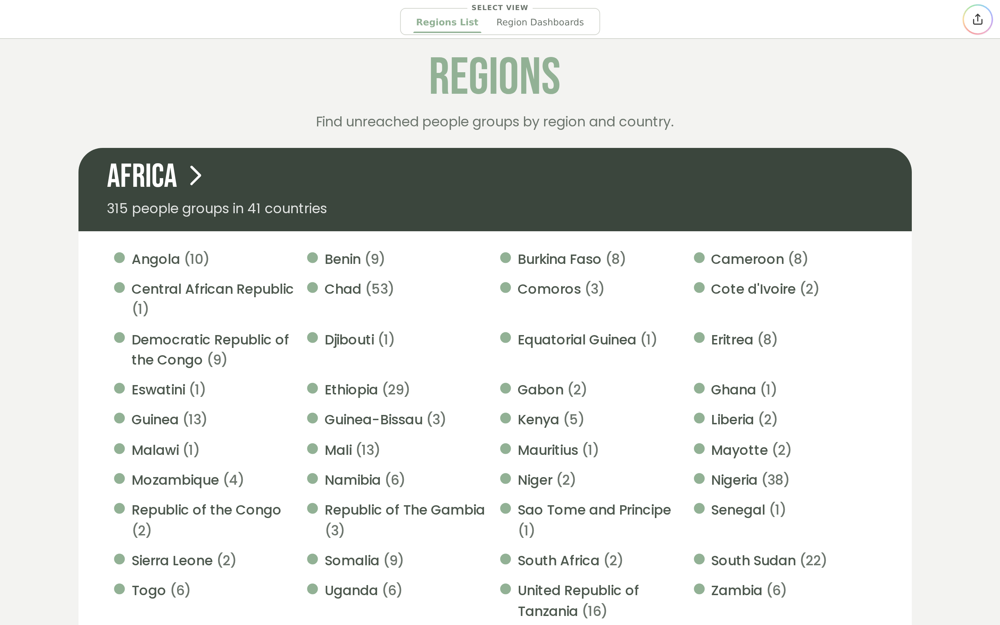<br><b>Regions</b><br><sub>every region and its countries, then a dashboard per region</sub></td>
<td width="25%" valign="top"><br><b>Prayer Progress</b><br><sub>where prayer is happening, and where it is still needed</sub></td>
</tr>
<tr>
<td width="25%" valign="top">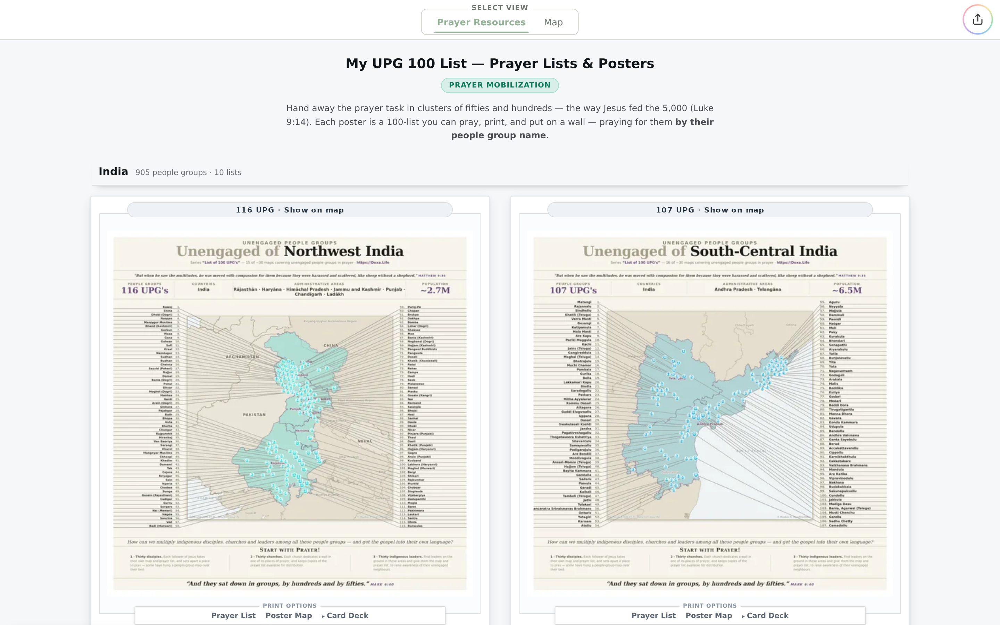<br><b>UPG100 Posters</b><br><sub>prayer lists of 100 people groups, with posters to print</sub></td>
<td width="25%" valign="top"><br><b>Cities with Internet</b><br><sub>internet access where unreached people groups live</sub></td>
<td width="25%" valign="top">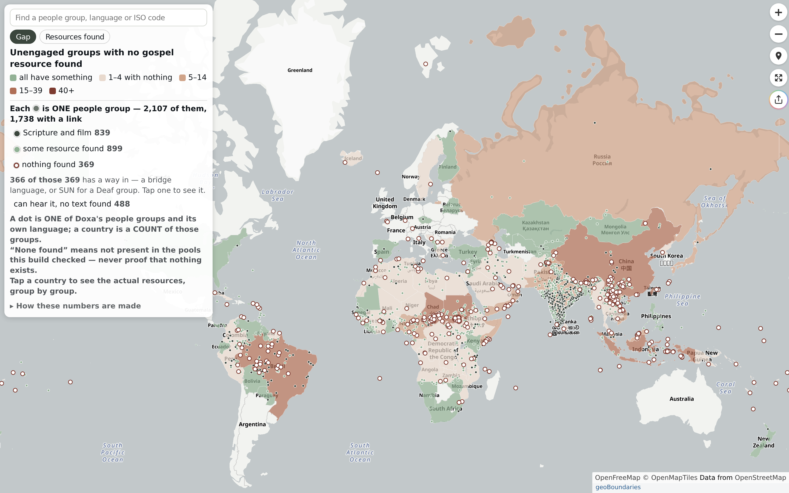<br><b>Gospel Resources</b><br><sub>which people groups have scripture, film or audio — and which have nothing</sub></td>
<td width="25%" valign="top"><br><b>Research Gallery</b><br><sub>all nine in one app — capability 5</sub></td>
</tr>
</table>

### On a phone

<table>
<tr>
<td width="25%" valign="top">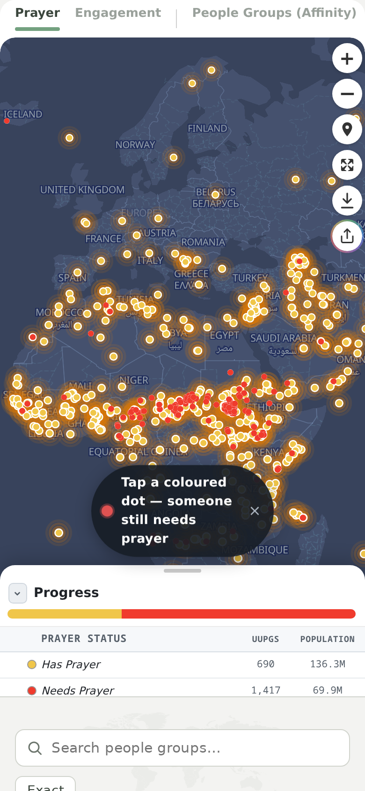<br><b>Simple Research</b></td>
<td width="25%" valign="top"><br><b>Regions</b></td>
<td width="25%" valign="top">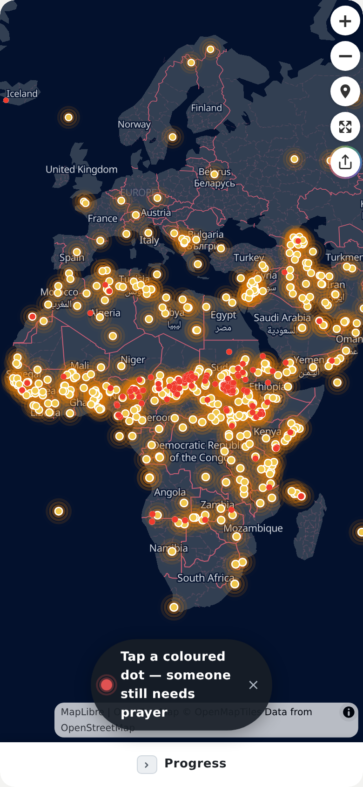<br><b>Prayer Progress</b></td>
<td width="25%" valign="top"><br><b>UPG100 Posters</b></td>
</tr>
<tr>
<td width="25%" valign="top"><br><b>Cities with Internet</b></td>
<td width="25%" valign="top"><br><b>Gospel Resources</b></td>
<td width="25%" valign="top">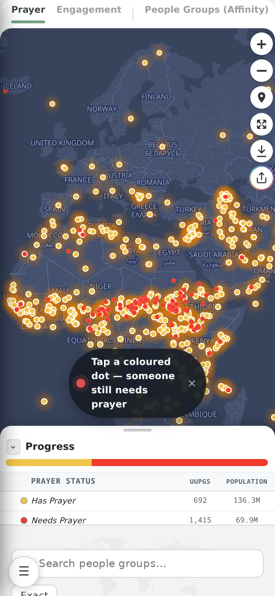<br><b>Research Gallery</b></td>
<td width="25%" valign="top"><b>Big Picture</b><br><sub>a desktop dashboard by design — on a phone, Simple Research is the dashboard, and the Research Gallery opens on it.</sub></td>
</tr>
</table>

### Print your first poster

1. **Open a poster wall:** *UPG100 Posters*, *Country Posters*, or *Regions* (its **View country posters**
   button). Every card on the wall has a **Print Options** strip. India's whole-country poster isn't
   available yet; its state posters are.
2. **Pick what to print:** **Poster Map** (the poster), **Prayer List** (choose **Full detail** or
   **Lightweight**) or **Card Deck** (choose a card size). On *UPG100 Posters*, clicking the poster
   picture prints it too.
3. **Your browser's print window opens, and it is the preview.** Choose the printer and print. Nothing
   is downloaded; to keep a file, choose **Save as PDF** instead of a printer.

Posters, lists and packets print on Letter-size pages (8.5 × 11 in). Cards print at their own size:
2.5 × 3.5 in, 4 × 6 in or A6.

**Bigger posters.** *Bible Posters* and the *Wall of People Groups* also offer bigger sizes, up to 5 × 8
ft, for a print shop: in the print window choose **Save as PDF** and send the file. The Wall's 5 × 8 ft
poster prints as 3 sheets, one per page, stacked so that each overlaps the next by 6 in; every sheet is
numbered (1 / 3, 2 / 3 …) and marked **glue here** where the next one goes.

**On a phone.** The same print window rises over the page; choose **Save as PDF** to keep the file or
send it on. A phone prints page sizes only (Letter or A4 paper), and the largest poster sizes are
switched off there. A few prints say they need a computer: *Bless India Posters*, the *Wall of People
Groups* and a selection of more than 1,000 groups on *UPG100 Posters*.

### Every capability ships every way

| Capability | Example | iframe | Mobile app | JavaScript embed | WordPress / Disciple Tools | Desktop |
|---|---|:-:|:-:|:-:|:-:|:-:|
| **5 — app shell** | Research Gallery | ✅ | ✅ | ✅ | 🧪 | ✅ |
| **4 — composite** | UPG100 Posters | ✅ | ✅ | ✅ | 🧪 | ✅ |
| **3 — multi-view** | research map | ✅ | ✅ | ✅ | 🧪 | ✅ |
| **2 — presets** | Prayer Progress | ✅ | ✅ | ✅ | 🧪 | ✅ |
| **1 — single element** | all people groups | ✅ | ✅ | ✅ | 🧪 | ✅ |

<sub>✅ works today · 🧪 proven, not yet in production. Every plugin builds into the same folder, and that folder is what all five methods ship — so a capability never limits where a plugin can go.</sub>

### The Experimental shelf

**New plugins the Research Gallery picks up by itself** — each builds and embeds like any other,
and graduates to a named tab when it's ready.

<table>
<tr>
<td width="50%" valign="top">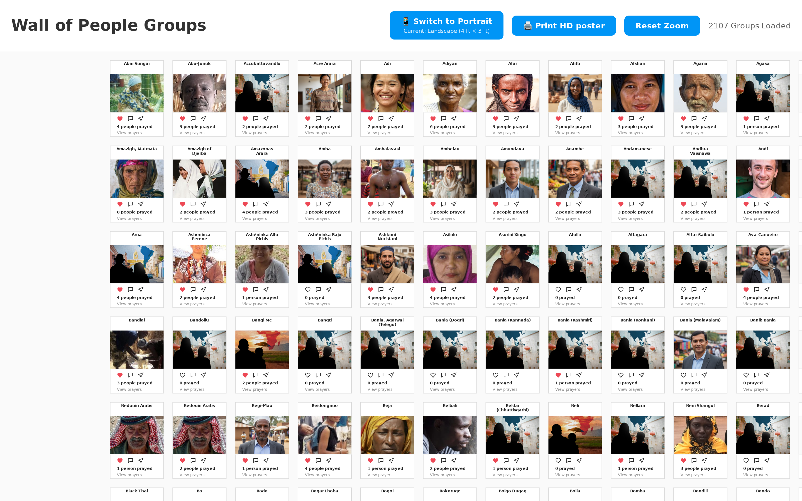<br><b>Wall of People Groups</b><br><sub>all 2,107 Doxa people groups as photo cards on one zoomable prayer wall, with a pray dialog</sub></td>
<td width="50%" valign="top"><br><b>Prayer Walk Planner</b><br><sub>plan a prayer walk through a zone, open it full screen from any embed, and print a walking map that stays sharp when zoomed</sub></td>
</tr>
</table>

<sub>Also on the shelf: UPG neighbor, all people groups, country posters, the vision card, and the PPLR data maps.</sub>

<details>
<summary><b>How one build becomes three outputs — the "map cruncher"</b></summary>

```text
 map · map · map · map · map · map · map        many maps, each once its own codebase
   \    \    |    |    |    /    /
    +----- plugin-designs/ ------+              one folder per plugin — the free zone
                 |
           library/ (@map)                      shared, reusable pieces — the high bar
                 |
            ONE build step
                 |
          public/dx-maps/                     OUTPUT 1: one drop-anywhere web folder
          /       |        \                   how a page shows a map:
      iframe   JS embed   WordPress            (WordPress just for fun)

    the same folder, wrapped:
    mobile app (OUTPUT 2) · desktop app (OUTPUT 3)
```

</details>

---

## Who it's for

### Vibe coders — who dx-maps was built for

If you build with AI agents, this repo is made for you:

- **One repo, many plugins.** Each plugin is one folder in `plugin-designs/` with its own `src/`,
  and they all share one library, so your agents can build many plugins side by side.
- **See every design live.** `bun run dev` opens the Plugin Studio: every plugin in one place,
  updating the moment you save.
- **Speak instead of typing.** Rudder, an offline voice-to-text tool, sits as a corner widget in the
  Studio: look at a plugin, say what you see, and hand the text to your agent. Nothing leaves your
  computer. It also runs as its own desktop app.
- **One plugin, several outputs.** The same code ships as a web embed, a mobile app or a desktop app
  ([the desktop app](#output-3--the-desktop-app--works-today)).
- **Build together.** [Run it in the cloud](#run-it-in-the-cloud) gives a whole team one shared dev
  server.

### The people doing the work

**Each map answers a real task for someone doing the mission.** Open it in the Research Gallery, or
embed just the one you need.

| You are… | Open | It answers |
|---|---|---|
| a **translator** (or an AI translation pipeline) | Gospel Resources (map, list, data tables) | which people groups have no Scripture, film or audio in their language, and which bridge language already reaches them |
| **media to movements** | Cities with Internet · Gospel × Internet | where unreached people groups live with internet access, country by country and down to province where data exists |
| a **catalyst** or mobilizer | Big Picture · Prayer Walk Planner · UPG100 Posters · Gospel × Internet | find **gospel resources** for the people you are reaching real time, build prayer walking maps for real outreach, as you prayer walk each key zone in your cities of choice, find indigenous disciples, groups, and leaders mobilize them each to have prayer packets, cards and posters to blanket all the people groups in prayer as a prayer mobilizer catalyst  |
| **praying** | Prayer Progress · UPG100 Posters | where prayer is covered and where it is still needed; print a **Prayer List**, **Poster Map** or **Card Deck** for a list of 100 |
| a **teacher** or presenter | the Research Gallery | every map in one app, multiple languages support |

<details>
<summary><b>For AI agents</b></summary>

- **Every map, and how to embed it:** `public/dx-maps/manifest.json` lists each plugin with its
  `embed.iframe` and `embed.script` snippet (with its integrity hash).
- **The data behind the maps:** `public/dx-maps/assets/tables/*.json` (gospel access, internet
  access, bridge languages, resource links…), `assets/people-groups/*.json` (points and slim
  records) and `assets/people-groups/lists/` (the membership of each list).
- **Live people-group data (public, no key):** `https://pray.doxa.life/api/people-groups/list`
  and `…/detail/{slug}`, the same endpoints the published maps call.
- **Switches on any map page:** `?lang=` (11 languages), `?provider=maplibre|mapbox`,
  `?list=` (a project list such as `700`), `?tk=` (a Mapbox token). Embeds take the same keys in
  `profile-config`. Contract: [documentation/reference-universal-props.md](./documentation/reference-universal-props.md).

</details>

---

## The 5 plugin capabilities

A capability is **how much a plugin nests**, from one element (1) to an app of apps (5). Every
screenshot is a real plugin from this repo's build.

### Capability 5 — app shell: the Research Gallery

**One plugin that holds every map as a tab** — and each tab is still a plugin you can embed on its own.


<details>
<summary><b>More about capability 5 — the app shell</b></summary>

An app shell is the outer frame of a whole app: a rail of tabs down the side, a header, and
navigation. Each tab loads a **real plugin** from a lower capability, only when you open it, so the
app stays fast. Nothing is copied into the shell: when a plugin improves, the shell shows the
improvement on the next build.

- **Where it lives:** `plugin-designs/doxa-maps-spa/` — one element, `<doxa-maps-spa>`.
- **Changing the tabs:** the order and grouping are one list, `NAV_MODEL` in `doxa-maps-spa.vue`.
- **New plugins show up by themselves:** any plugin that isn't placed in a section lands on the
  folded **Experimental** shelf, read from the built `manifest.json` — no code to edit.
- **A second app shell ships too:** the Plugin Studio (below),
  which holds *every* plugin for developers.

</details>

<details>
<summary><b>What the Research Gallery is made of — seven production maps, two poster plugins, an Experimental shelf, all five capabilities in one plugin</b></summary>

```text
Research Gallery                          <doxa-maps-spa>          capability 5
├─ Dashboards
│  ├─ Big Picture                         dashboard-plus-grid      capability 4
│  │   ├─ research dashboard              research-dashboard       capability 3
│  │   └─ people-groups grid              people-groups-grid       capability 2
│  ├─ Simple Research                     research-map-plus-grid   capability 4
│  │   ├─ research map                    doxa-research-map        capability 3
│  │   └─ people-groups grid              people-groups-grid       capability 2
│  └─ Regions                             regions-mfe              capability 4
│      ├─ regions list                    regions-list             capability 1
│      └─ region dashboards               region-dashboards        capability 1
├─ Prayer Mobilization
│  ├─ Prayer Progress                     doxa-simple-map          capability 2
│  ├─ UPG100 Posters                      upg-100-mfe              capability 4
│  │   ├─ zoned map                       upg-100-list             capability 1
│  │   └─ poster wall                     poster-wall              capability 1
│  ├─ Country Posters                     country-posters-mfe      capability 4
│  └─ Poster Design                       poster-design-mfe        capability 4
├─ Gospel Research
│  ├─ Cities with Internet                connectivity-map         capability 1
│  └─ Gospel Resources                    resources-map            capability 1
└─ Experimental (a folded shelf, filled automatically from manifest.json)
   ├─ prayer walk planner                 prayer-walk-planner      capability 1
   ├─ UPG neighbor                        upg-neighbor             capability 3
   ├─ all people groups                   all-people-groups        capability 1
   ├─ vision card                         doxa-vision-card         capability 2
   ├─ PPLR data maps                      pplr-data-maps           capability 3
   └─ Wall of People Groups               wall-of-people-groups    capability 3
```

</details>

### Capability 4 — composite: plugins wired together

**Several plugins glued into one**, talking to each other — and each piece still embeddable alone.


| List (capability 1, embeddable alone) | Poster wall (capability 1, embeddable alone) |
|---|---|
|  | 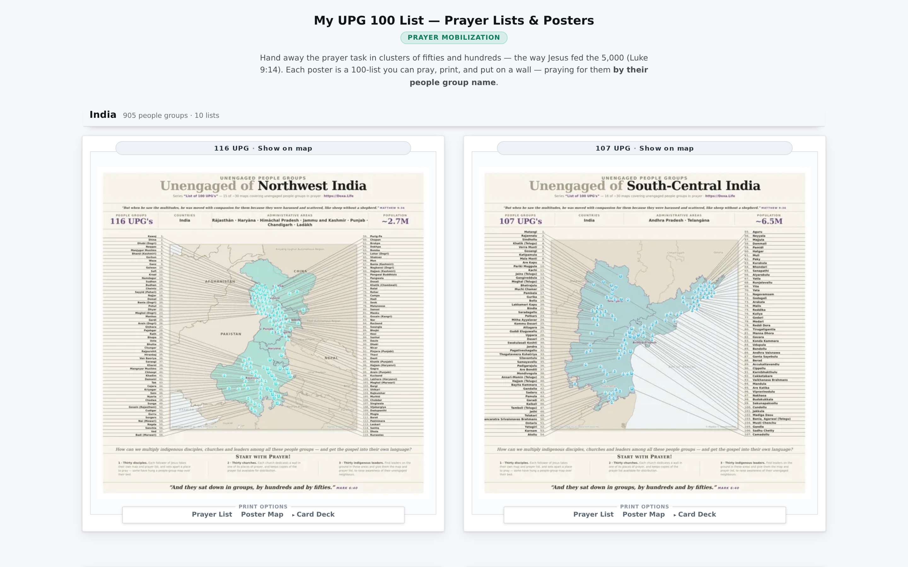 |

<details>
<summary><b>More about capability 4 — composites</b></summary>

A composite takes plugins that already exist and places them together — side by side, stacked, or
as views you switch between — and ships the set as **one new element**. The pieces talk through
**props** (settings passed in) and **events** (messages sent out): click a region in one piece and
another piece updates. Nothing is copied, so each piece can still be embedded on its own.

- **Example:** `plugin-designs/my-upg-100-list/` — the UPG100 Posters zoned map and its poster wall, joined into
  `upg-100-mfe`. Big Picture, Simple Research and Regions are composites too.
- **How to declare one:** a `<name>.meta.json` beside it with `"type": "nested-elements-mfe"` and a
  `"composes"` list of the plugins inside.
- **The layouts that do the placing:** `VerticalTabsLayout` and `StackLayout` in `library/layouts/`.

</details>

### Capability 3 — multi-view: many screens, one element

**One plugin with several screens inside** — tabs you switch between.


<details>
<summary><b>More about capability 3 — multi-view</b></summary>

All the screens live in one plugin, so they share code and data and switch instantly. The trade-off:
you embed the whole thing — you can't embed just one of its tabs. When you need that, split the tabs
into separate plugins and join them with a composite (capability 4).

- **Example:** `plugin-designs/doxa-research-map/` — Prayer, Engagement, People Groups, Regions,
  Languages and Religions in one map.
- **How to declare one:** a `<name>.meta.json` with `"type": "monolithic"`.

</details>

### Capability 2 — presets: one plugin, many maps

**The same map code, several ready-made versions** — each with its own page and embed code.

| Prayer | Engagement | Adoption |
|--------|------------|----------|
|  |  | 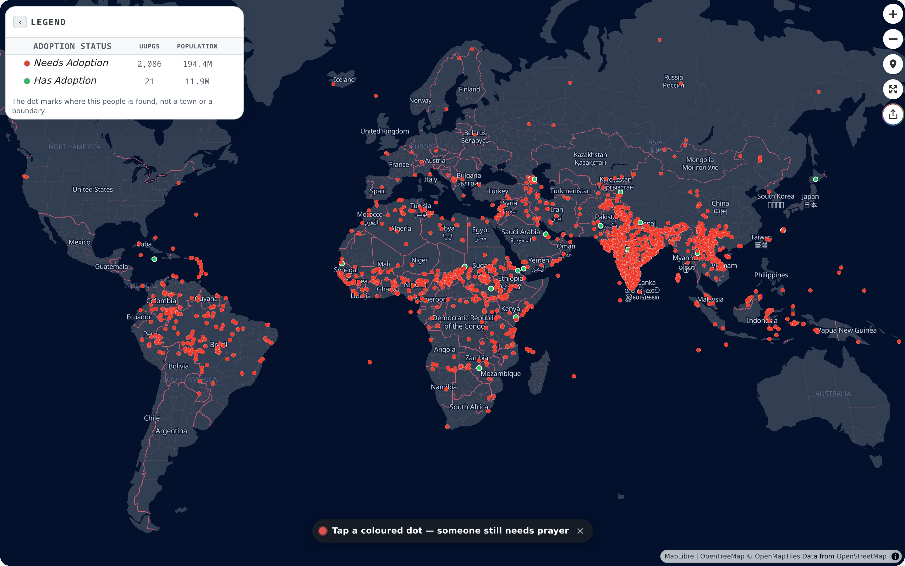 |

<details>
<summary><b>More about capability 2 — presets</b></summary>

You write one map, then list its versions in a small table: a name and the settings for each. The
build turns every row into its own standalone page and embed snippet — same code, different map.
Adding a version means adding a row, not writing code.

- **Example:** `plugin-designs/doxa-simple-map/` — Prayer, Engagement and Adoption from one map.
- **How to make one:** add `<name>.instances.json` beside the plugin:
  `{ "instances": [{ "id": "prayer", "title": "Prayer", "props": { … } }] }`.

</details>

### Capability 1 — single element

**One folder, one map, one tag** you can paste into any page.

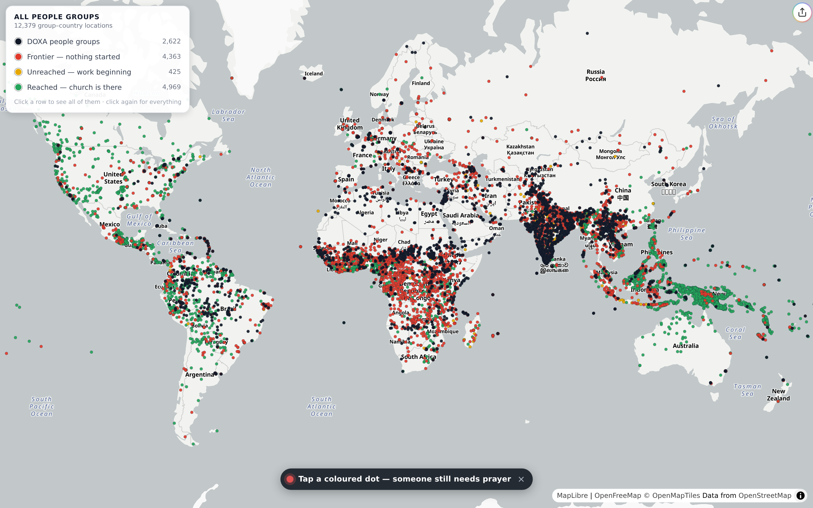

<details>
<summary><b>More about capability 1 — single element</b></summary>

The simplest plugin, and where every map starts: a folder with three files — the map's `.vue`, an
`index.js` that registers its tag, and an `index.html` for previewing it (under `bun run dev`, a plugin's own
page is `/__leaf/<plugin>/<profile>`). The build turns it into
one custom HTML tag, like `<all-people-groups>`, that works on any web page.

- **Example:** `plugin-designs/all-people-groups/` — every people group on one map.
- **How to make one:** copy `plugin-designs/template-bundle/` to `plugin-designs/<your-map>/` and
  rename it. The studio finds it automatically.
- **Which plugin is the example of each capability** is generated, not remembered:
  [documentation/reference-capability-exemplars.md](./documentation/reference-capability-exemplars.md).

</details>

---

## What the build makes — 3 outputs

**One build step makes one folder. That folder is the product** — every other choice is *where you
put it* and *how a page shows it*.

| # | Output | What it is | Status |
|---|---|---|---|
| **1** | **The web folder** `public/dx-maps/` | every map, each embeddable on its own, all working together — 1367 files, 163 MiB (about 170 MB) | ✅ production |
| **2** | **Mobile app** | the same folder, wrapped as an Android app by Capacitor | ✅ built |
| **3** | **Desktop app** | the same folder, wrapped as a desktop app by Tauri | ✅ works today |

### Output 1 — the web folder

Two questions: **where does the folder go** (hosting), and **how does a page show a map** (embedding).

#### Where the folder goes: three routes

**The easiest path: drop-in.** The folder goes into your own site's `public/`, and your site's own server
serves every map: one server, no PocketBase, nothing else to run. Set `dropin.dest` in
`vite.doxa-maps-build-config.json` to your site's `public/` (the default is `../doxa-life/public`), then:

```bash
EMBED_BASE_URL=https://your-site bun run tree   # seconds: writes your address into the copy-paste snippets
bun run dropin                                  # copies dx-maps/ into your site's public/; the rest of the site is left alone
```

The built maps are already in the repo, so no build is needed. If you changed a plugin, rebuild just that
one first: `BUNDLE=<name> bun x vite build`. Without `EMBED_BASE_URL`, the pages still work, but the
snippets in `manifest.json` stay relative (`./…`) and other sites can't paste them. `bun run tree` rewrites
the manifests in this repo's `public/`; `git restore public` puts them back after the copy.

This route is proven on DX Life: real pages rendering maps, one server, every production map passing
its embed checks, copy-paste snippets included. Its drop-in branch copies the folder into `public/dx-maps`. Its
`/research` page shows the research map by itself, with a link to `/deep-research`, a page not in the menu that
holds the whole gallery as **Deep Research**.

**Embeds are pinned.** A host pastes a map's `embed.script` from `manifest.json`; its `integrity` hash
makes the browser refuse the bundle if it changed by even one byte, so copy the snippet again after each
release ([bundle integrity](#security-controls)).

**Subdomain: the dx-maps container with PocketBase.** When maps need a backend of their own (accounts,
saved data, an API for mobile apps), run the dx-maps container on its own subdomain, such as
`maps.your-site`. It serves the same folder with PocketBase beside it, and its schema ships as migration
files in the repo. The `Dockerfile` and `compose.yaml` sit at the repo root; recipe and settings:
[deployment/cloud/](./deployment/cloud/README.md).

**Plugin Studio: the public Studio, with PocketBase.** The highest route: the same container with
`ACCESS=public`, on your research subdomain.
- The Plugin Studio follows `development` and is open to everyone, so what agents add to the pilot shows up live.
- Its `/cdn`, built from `main`, serves your site's production maps.
- Publishing and PocketBase's dashboard ask for a password you set when you deploy; OIDC stays available.

Settings: [the public Studio](./deployment/cloud/README.md#public-studio-accesspublic).

| Route | What runs | Backend | Capability |
|---|---|---|---|
| Drop-in | your site's own server serves the folder | none | the simplest, for most sites |
| Subdomain | the dx-maps container on its own subdomain, behind a sign-in | PocketBase | accounts, saved data, an API |
| Plugin Studio | the container's public Plugin Studio on your research subdomain; your site embeds maps from its `/cdn` | PocketBase (a password now, OIDC-ready) | the highest: plugins built live in public, plus everything above |

<details>
<summary><b>More about the folder</b></summary>

- **The folder works from any address.** Every link inside it is relative, so it can sit at
  `https://your-site/dx-maps/` or at the root of a subdomain and nothing breaks (`bun run check:drop` proves it).
- **iframes need nothing special.** A map's page loads inside the frame from wherever the folder is.
- **JS embeds on another site need one header.** The embed loads scripts and `manifest.json` across
  sites with a security hash, so the host must allow it: `Access-Control-Allow-Origin: *`. The
  container sends it; a drop-in needs it only if other sites embed from yours.

</details>

#### How a page shows a map

##### iframe — the prayer map on any site ✅ production

**Paste one line of HTML and the map appears** — on any website, no coding.


<details>
<summary><b>More about the iframe</b></summary>

An iframe is a window in your page that shows another page — here, the map's own page. It's the
easiest way to share a map: it works on any site that accepts HTML, and the map keeps its own look.
Every plugin's exact snippet is `embed.iframe` in `public/dx-maps/manifest.json`:

```html
<iframe src="https://YOUR_HOST/dx-maps/doxa-simple-map/doxa-simple-map/prayer/index.html?utm_source=YOUR_SOURCE"
        width="100%" height="600" style="border:none;border-radius:12px;" allowfullscreen></iframe>
```

</details>

##### JavaScript embed — Deep Research for DX Life ✅ works today

**Two lines of code put a whole app inside your own page** — here, the Research Gallery, which DX Life
publishes as **Deep Research** on a page of its own (`/deep-research`).


*An earlier build, when the gallery sat on DX Life's research page with its tabs in the old order. It now has a
page of its own.*

<details>
<summary><b>More about the JavaScript embed</b></summary>

Instead of a window onto another page, the map becomes **part of your page**, so your page can talk
to it. On dx-life, one embed of the gallery is the whole `/deep-research` page, and the research page keeps
the research map by itself. The exact snippet is `embed.script` in `manifest.json`; copy its `integrity`
hash from there, because it changes with every build:

```html
<script>window.MAP_APP_API_URL="https://pray.doxa.life";</script>
<script src="https://YOUR_HOST/dx-maps/doxa-maps-spa/doxa-maps-spa.js"
        integrity="sha384-…" crossorigin="anonymous"></script>
<doxa-maps-spa profile-config='{"profile":"doxa-maps-spa","tk":"YOUR_MAPBOX_TOKEN","utmSource":"YOUR_SOURCE","assetsBase":"https://YOUR_HOST/dx-maps/assets"}'></doxa-maps-spa>
```

</details>

##### WordPress / Disciple Tools — 🧪 proven, just for fun

**We got a JAMstack map running inside WordPress and Disciple Tools.**


<details>
<summary><b>More about WordPress / Disciple Tools</b></summary>

It works, but it isn't yet a production feature of the map bundler. Two ways to try it:

- **Easiest:** paste the iframe or JavaScript snippet into a WordPress **Custom HTML** block.
- **As a plugin:** install `deployment/wordpress/doxa-maps-embed/` in `wp-content/plugins/`. It adds
  a `[doxa_map]` shortcode and a block for the block editor.

`bun run check:wp-embed` confirms the plugin writes the right HTML, without needing WordPress
installed.

</details>

### Output 2 — the mobile app ✅ built

**The same maps, wrapped as a phone app.** No new code — the maps are JAMstack: they fetch their data
from a remote API, which is exactly what a mobile app needs.

<p align="center"></p>

<details>
<summary><b>More about the mobile app</b></summary>

[Capacitor](https://capacitorjs.com) wraps the built folder into an Android app. Shown here: the
UPG100 prayer lists and posters at phone size, each poster with its own print options.

```bash
bun run check:mobile   # checks the app is wired up correctly — needs no Android tools
bun run phone          # builds the app and installs it on a phone or emulator
```

`bun run phone` needs the Android SDK, JDK 17 and `adb`. Only Android is set up; iOS is not yet.

</details>

### Output 3 — the desktop app ✅ works today

**Run it in your browser, then ship the same code as a desktop app.** [Tauri](https://tauri.app) wraps
it in a small Rust program that runs on your computer. Rudder, the offline voice-to-text plugin, is the
proof: its Linux desktop app works and is used to dictate the work on many of these maps. Its goal is
private voice-to-text that you own: offline, no telemetry, no cloud.

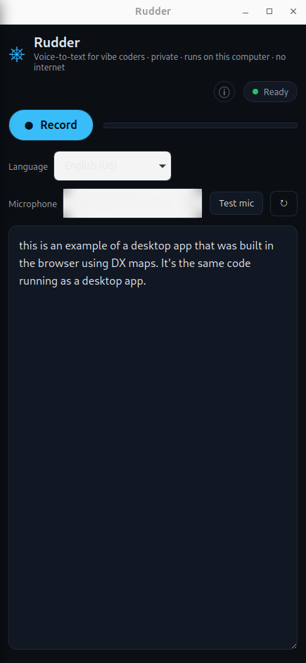

<details>
<summary><b>More: how it works, Rudder's goal, and what isn't run yet</b></summary>

**How it works.** What you build and try on the development server (`bun run dev`) is what ships to
the desktop; there is no second code base. Rudder runs as a corner widget in the Plugin Studio and as
its own desktop app, built with `bun run desktop:build rudder-voice`
([HOWTO-build-the-desktop-app](./documentation/HOWTO-build-the-desktop-app.md)): look at a plugin, say
what you see, and hand the text to an agent. The map app runs as a desktop app the same way.

**Rudder's goal, from the start: private voice-to-text that you own.**

- **Offline, with no telemetry and no cloud.** Your own code and your own self-hosted speech model
  (NVIDIA's open NeMo-Speech.cpp runtime and a small speech model, about 742 MB) run on a modest amount
  of your computer's CPU. After a one-time download of the runtime and the model, nothing needs the
  network; a trace of the speech runtime showed zero sockets and zero DNS lookups. The aim is that it
  works out of the box: today the first-run download is still a manual step.
- **Be careful who commits to Rudder.** A voice-to-text tool hears everything said near it, so one
  bad change could turn it into spyware. Take changes to `plugin-designs/rudder-voice/` and
  `backend/rudder-engine/` only from people you trust, and have a second person read every one.
- **Planned: an egress monitor** that shows you, as it runs, that Rudder sends no data out to anyone.

**What isn't run yet.** Tauri builds a Linux app and a `.deb` installer today. The macOS and Windows
builds are set up but have not been run ([the HOWTO](./documentation/HOWTO-build-the-desktop-app.md)
says which steps are proven). The desktop build runs on demand with the commands below; the automatic
production build doesn't make it yet. The Research Gallery could become a strong desktop app too.

```bash
bun run check:tauri    # checks the desktop setup — needs no Rust tools
bun run tauri:build    # builds the app — needs Rust, the Tauri CLI and webview libraries
```

</details>

<sub>WordPress and Tauri marks from [Simple Icons](https://simpleicons.org) (CC0); the trademarks belong to their owners.</sub>

---

## Security controls

**Bundle integrity.** Every bundle ships with a SHA-384 hash in `public/dx-maps/manifest.json`
(`bundles[].integrity`), and every copy-paste script snippet (`profiles[].embed.script`) already
uses it:

```html
<script src="https://YOUR_HOST/dx-maps/doxa-simple-map/doxa-simple-map.js"
        integrity="sha384-…" crossorigin="anonymous"></script>
```

If the file on the host is changed by anyone, even by one byte, the browser refuses to run it.
`crossorigin="anonymous"` is required for the check to work across sites, so the host must send
`Access-Control-Allow-Origin: *`. Copy the snippet again after each release, because the hash changes
with the bundle. `bun run check:sri` keeps the manifest and the built pages in step.

<details>
<summary><b>The backend in the cloud container (v1, experimental)</b></summary>

- **Locked by default.** A new PocketBase collection starts with admin-only rules; you open it
  deliberately, collection by collection.
- **Dashboards hidden.** The production instance exposes only its `/api/`; its admin dashboard is
  blocked at the proxy. The development dashboard is open only to the admin group.
- **No server-side code.** PocketBase's JavaScript hooks are switched off in both instances.
- **Not built yet:** per-plugin locks between plugin authors (who may edit which plugin's backend)
  and isolated edge functions. Until they exist, everyone with dev access is trusted with every
  plugin's backend.

</details>

---

## Languages

**Every map speaks 11 languages** — add `?lang=<code>` to a map's page address, or, when a map is embedded in
your own page, set `"locale"` in its `profile-config`. Arabic reads right to left.


<sub>UPG100 Posters with `?lang=ar`: the interface is in Arabic; people-group and place names come from the data.</sub>

| Code | Language | | Code | Language |
|---|---|---|---|---|
| `en` | English | | `hi` | हिन्दी — Hindi |
| `ar` | العربية — Arabic (right to left) | | `it` | Italiano — Italian |
| `de` | Deutsch — German | | `pt` | Português — Portuguese |
| `es` | Español — Spanish | | `ro` | Română — Romanian |
| `fr` | Français — French | | `ru` | Русский — Russian |
| `zh` | 中文 — Chinese | | | |

<details>
<summary><b>More about languages</b></summary>

- **Pick a language with the address:** `…/prayer/index.html?lang=fr` shows the map in French. It
  works on every map's own page and on the Research Gallery. `?locale=` works too.
- **Set it from your own page:** when you embed the Research Gallery or a single map with the
  JavaScript embed, put the language in its `profile-config` (`"lang"` works too). Set it again
  later and the map switches language live.

  ```html
  <doxa-maps-spa profile-config='{"locale":"ar"}'></doxa-maps-spa>
  ```
- **Without either,** a map follows the page's own language (`<html lang>`, which WordPress sets), and
  otherwise shows English.
- **Right to left:** in Arabic the map's layout mirrors — the Research Gallery's tab rail moves to
  the right. Set through `profile-config`, only the map's own box mirrors; the rest of your page is
  left alone. A `?lang=ar` address mirrors the whole page, which is what a map's own page wants.
- **Where the words live:** `library/i18n/locales/<code>/`, one folder per language. Adding a
  language: [documentation/architecture/i18n.md](./documentation/architecture/i18n.md).

</details>

---

## Build it with an agent swarm

**Many AI agents can build many plugins at once without breaking each other's work.** Every plugin
has one agent that owns it, and the work moves through three kinds of branch:

- **The pilot branch (`development`)** is where reviewed PR branches come together. A pilot server
  with hot reload follows it, so each change that joins can be seen there within about 15 seconds.
- **The landing branch (`main`)** is what ships. It moves only when a person approves a publish, and
  the landing server rebuilds from it.
- **PR branches** hold one plugin or feature each. They start from the pilot branch, take in the latest
  pilot by merging (never rebasing), and join it one at a time, after the checks pass and a second agent,
  usually the repository's agent, has read the change.

**It scales by adding PR branches, not by sharing one.** Many people, each with several agents, can
work on many plugins at the same time: every plugin or feature gets its own PR branch, and each one
can be seen on the pilot server as soon as it joins the pilot.

**Bring your own harness.** dx-maps works with whatever AI coding agent or agent harness you already
use. The repo gives you the branch strategy below, the checks (`bun run gates:pre`) and the Plugin
Studio; it does not ship a harness. There are three roles: one agent per repository, which handles its
branches and watches the work being done in it; one agent per plugin; and one shepherd agent that all the
other agents talk to, which keeps order and puts the merges onto the pilot in order. Your harness gives
these jobs to its agents.

![The delegation model: the pilot branch (development) at the centre behind the pilot lock; publishing to the landing branch (main) and its outputs below it; inside the Plugin Studio; eight plugins around it, each owned by one agent; a shepherd and a repo agent over the plugin agents; below, how a change joins the pilot and then reaches the landing branch, in four steps, the three outputs, and how it scales: one PR branch per plugin, a self-hosted git service, and publishing to a public host only from the landing branch](documentation/readme-images/delegation-model.png)

<sub>[Open the diagram full size](documentation/readme-images/delegation-model.png): on a phone its small text needs it.</sub>

### Set up the branch strategy

1. **The landing branch (`main`) is what ships.** It moves only when a person approves a publish (step 7).
2. **The pilot branch (`development`) is the shared working branch.** Create it once, from `main`:
   ```bash
   git fetch origin && git switch -c development origin/main && git push -u origin development
   ```
3. **One PR branch and worktree per feature**, each started from the pilot branch, then install
   once in each:
   ```bash
   git worktree add -b regions/work ../dx-maps-regions origin/development
   git worktree add -b upg100/work  ../dx-maps-upg100  origin/development
   cd ../dx-maps-regions && bun install --frozen-lockfile
   ```
4. **One preview server per agent on your own machine, each on its own port** (in the cloud, the one
   pilot server below takes this role):
   ```bash
   bun x vite --port 5301 --strictPort    # the next agent uses 5302, and so on
   ```
5. **Join the pilot one at a time, through a lock that works like a merge queue.** First merge the
   latest pilot into your PR branch (merge, never rebase) and fix any clash there. A second agent reads
   the change, and looks at it on screen where it shows. Then, inside the lock, merge the pilot once more
   in case it moved, run the checks (`gates:pre`, `gates:post`) and the landing checks (fresh bundles,
   the tree, the integrity hashes, no conflict markers), and push only if nothing fails:
   ```bash
   git fetch origin && git merge --no-edit origin/development    # on your PR branch: the latest pilot
   flock /tmp/dx-maps-development.lock sh -c '
     git fetch origin && git merge --no-edit origin/development &&
     bun run gates:pre && bun run gates:post &&
     node internal/landing-preconditions.mjs &&
     git push origin HEAD:development'
   ```
   If the merge stops on a conflict, run `git merge --abort`, fix the clash on your PR branch and join
   again. `flock` guards one machine. Agents on several machines need a shared lock, such as one your
   harness provides.
6. **Each change rebuilds what it touches.** There is no single build owner: rebuild every bundle your
   change reaches, then the tree and the integrity hashes, and commit them with the change. The landing
   checks refuse a change whose bundles are stale:
   ```bash
   BUNDLE=<name> bun x vite build      # each bundle your change reaches
   bun run tree && bun run fix:sri     # then the tree and the integrity hashes
   ```
   Only a change to the build itself (its config or its dependencies) reaches every bundle:
   `BUILD_ALLOW=1 bun run build`.
7. **Publish, when a person approves it:** make sure the release the landing branch is on now has its
   own version tag (that tag is the rollback point), fast-forward the landing branch to a pilot commit
   that passed the checks, tag it, and deploy from the tag:
   ```bash
   git fetch origin && git switch main && git merge --ff-only origin/main
   git tag -a v0.2.0 -m "Release v0.2.0" && git push origin v0.2.0   # the outgoing release, if untagged
   git merge --ff-only <development-commit>   # a commit that passed the checks
   bun run gates:pre && bun run gates:post    # the checks must pass on exactly this commit
   git tag -a v1.0.0 -m "Release v1.0.0" && git push origin main v1.0.0
   ```
   The tag's `public/dx-maps/` folder is the built site: deploy that, and build the landing demo from
   the same tag ([how to deploy](./documentation/DEPLOY.md)). To go back, deploy the previous release's tag. Publish to a public host, such as GitHub, only from
   the landing branch and only when it is ready.

### Developing in the cloud with a swarm

Keep the repository on a git service you host yourself: a swarm pushes often, and an agent can
publish by accident. On a public host, one wrong push publishes work you did not mean to share, so
publish there only from the landing branch, when it is ready. Give each app two servers: a **pilot server** that
follows the pilot branch with hot reload, and a **landing server** that rebuilds from the landing
branch. The cloud container in `deployment/cloud/` runs both today (`BRANCH=development` for the pilot server,
`PRODUCTION_BRANCH=main` for the landing server; `BRANCH` defaults to `main`). One pilot server per app, rather
than one per pull request, keeps the memory the same however many pull requests are open. Each
developer can still build on their own machine with the Plugin Studio and push their branch.

Planned, not built yet: switching the pilot server to show one pull request at a time (with a table of
the open pull requests under it), and rebuilding the landing branch from the accepted pull requests in
order, so a rejected one is simply left out of the next rebuild.

How to contribute, and the bar for shared code: [documentation/CONTRIBUTING.md](./documentation/CONTRIBUTING.md).
Taking contributions from a contributor's own forge into your GitHub repository: [documentation/contribute/TUTORIAL.md](./documentation/contribute/TUTORIAL.md).
Diagram source: [`delegation-model.svg`](./documentation/readme-images/src/delegation-model.svg).

<details>
<summary><b>What problem does this solve? (in plain words)</b></summary>

All the maps here share **one project, one library and one build step**. That's what makes them
work together, and it's also the danger: if one agent's change breaks the shared library, **every
map breaks at once**. And when several agents work in the same project at the same time, they step on
each other — two agents edit the same file, one change quietly erases another, or half-finished work
ends up in the version everyone else is using.

So the project works like a busy kitchen:

1. **Each agent works in its own branch and copy of the project** — its own counter, so nobody bumps
   anybody. One owner per plugin, and one per shared file.
2. **Only one change joins the pilot at a time.** Whoever holds the *pilot lock* first catches up with
   everyone else's latest work, fixes any clash itself and runs every check; the change goes into the
   pilot branch only if nothing fails. The pilot branch always works.
3. **Someone keeps order.** One shepherd agent, which all the other agents talk to, keeps order and puts
   the merges onto the pilot in order; one agent per repository handles its branches and watches the work
   being done in it. Your harness gives these jobs to its agents.
4. **The landing branch moves only when a person approves a publish**, after the checks pass on that exact version.
   The pilot server follows the pilot branch; the landing server rebuilds from the landing branch.

That's how many plugins get built at the same time, in one project, without the maps breaking.

</details>

<details>
<summary><b>The words, if you're new to git</b></summary>

| Word | In plain terms |
|---|---|
| **repo** | the project folder, with its full history |
| **development** (the pilot) | the shared working version: every agent's change is added here, one at a time |
| **main** (the landing) | the version that ships: it moves only when a person approves publishing `development` |
| **worktree** | a private copy of the project for one agent to work in |
| **merge conflict** | two changes touched the same lines; someone has to decide how to combine them |
| **merge** | taking everyone else's latest work into your branch: the latest pilot goes into your PR branch (never a rebase), before joining and once more inside the pilot lock |
| **pilot lock** | only one change merges onto `development` at a time; its holder catches up and runs every check first |
| **tag** | a fixed name for one release commit, such as `v1.0.0`, so you can always deploy exactly it |

</details>

---

## The Plugin Studio — ★ where you work

**Every plugin in one place, sorted by capability.** Pick any plugin to run it live, fold open the
plugins inside it, and copy its embed code. Tell your agent which plugins to **group**, and it builds
a higher-capability plugin from them — that's how the Research Gallery was built.

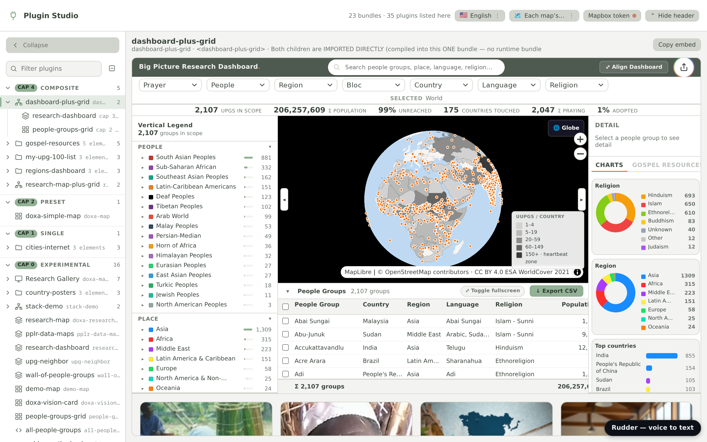

### Get it running

You need **git**, **[Bun](https://bun.sh)** and **Node ≥ 18**. The maps draw with the keyless MapLibre engine
by default; for Mapbox, add a free **[Mapbox](https://account.mapbox.com) public token** (it starts with `pk.`)
and choose `"provider": "mapbox"` (see *No Mapbox token?* below). For Rudder's voice engine, also **[Go](https://go.dev/dl/) 1.22+**, then run
`bash backend/rudder-engine/setup-runtime.sh` once; without Go, everything except voice works.

```bash
git clone --depth 1 <your-repo-url>   # latest code only: seconds, not hundreds of MB of history
cd doxa-maps
bun install --frozen-lockfile
cp .env.example .env.local      # optional: paste your pk. token after VITE_MAPBOX_TOKEN= (.env works too; .env.local wins)
bun run dev                     # → open the URL Vite prints: that page is the Plugin Studio
```

No build needed first — the built maps are already in the repo. `bun run dev` also starts a local
PocketBase on port 8090 for the plugins that use a backend; it is downloaded on the first run (if 8090 is
taken, set `DX_PB_PORT` to any free port in `.env.local` and restart `bun run dev`). To start a
plugin, copy `plugin-designs/template-bundle/` to `plugin-designs/<your-map>/`; the studio finds it
automatically. Then rename it as its own `README.md` says. Each plugin also has its own page while
`bun run dev` runs, at `/__leaf/<plugin>/<profile>` (for example `/__leaf/all-people-groups/all-people-groups`), and the
Studio's list of plugins is `/__plugin-gallery/manifest.json`.

To put the maps on your own site, take [the easiest path: drop-in](#where-the-folder-goes-three-routes).

<details>
<summary><b>Make changes to the studio itself</b></summary>

The studio is a plugin like any other: `plugin-designs/plugin-studio/plugin-studio.vue`.

1. Run `bun run dev` and open the URL Vite prints (http://127.0.0.1:5173/ unless that port is taken) — that page *is* the studio.
2. Edit `plugin-studio.vue` (or ask your agent to). The page updates as you save.
3. When it looks right, build just the studio and refresh its security hashes:

   ```bash
   BUNDLE=plugin-studio bun x vite build
   bun run fix:sri
   ```

4. Check it opens every plugin, with `bun run dev` running: `bun run smoke:studio -- --url <the URL Vite printed>`.
   It drives a headless browser (Playwright's Chromium).

</details>

<details>
<summary><b>No Mapbox token? And other map settings</b></summary>

- **No token:** nothing to do. Every map draws with MapLibre by default, which needs no key. Mapbox is an
  explicit choice: `"provider": "mapbox"` on a plugin (or `?provider=mapbox` on a map's page), plus a token.
- **Built pages** take a token from `?tk=pk.…` in the address, from a token you paste once into the
  page, or from a token endpoint.
- Every command and prerequisite, per deployment method:
  [documentation/README-SECTION-3-cli-commands.md](./documentation/README-SECTION-3-cli-commands.md).

</details>

| Command | What it does |
|---|---|
| `bun run dev` | The Plugin Studio, updating as you save, at the URL Vite prints |
| `BUNDLE=<name> bun x vite build` | Build one plugin only |
| `BUILD_ALLOW=1 bun run build` | Build everything into `public/dx-maps/` (~4 min; refuses without the flag, to protect a shared project) |
| `bun run serve` | Serve the built output folder — the Plugin Studio is http://localhost:4173/dx-maps/index.html (`PORT=<n> bun run serve` if 4173 is taken) |
| `bun run gates:pre` · `bun run gates:post` | The checks that keep `main` working |
| `bun run shots` | Retake these screenshots (`ONLY=<name>` for one) |

### Run it in the cloud

**One shared dev server for the whole team, no laptop setup.** A container clones the repo, follows
`development`, and hot-reloads every change that joins the pilot, so everyone sees the Plugin Studio update in
their browser within seconds, with no rebuild. Add OIDC settings and it puts a "Sign in with *your
provider*" page in front of everything, open only to the groups you allow. Recipe and settings:
[deployment/cloud/](./deployment/cloud/README.md).
Working from your own laptop alongside the team (zero config, everything local by default):
[documentation/HOWTO-join-the-table.md](./documentation/HOWTO-join-the-table.md).
The three ways dx-maps ships (a drop-in into your own site, the container on its own subdomain, or the public Plugin Studio):
[the three routes](#where-the-folder-goes-three-routes) and [documentation/DEPLOY.md](./documentation/DEPLOY.md).

### Cloud development environment

**Your laptop can follow what agents add to the pilot somewhere else.** By default `bun run dev` is fully local: no
settings, nothing fetched, and only your own edits hot-reload. To also see what agents push to a shared
branch (an agent on a server, or the whole team), add two lines to `.env.local` (gitignored):

```bash
DX_SYNC_REMOTE=origin          # a remote name or a repo URL; a private repo uses your usual git credentials
DX_SYNC_BRANCH=development     # the default: your team's shared branch (the public repo has only main)
```

Every few seconds the dev server fetches that branch, fast-forwards your checkout and hot-reloads what
changed. It never merges over your work: it pulls only when you are on that branch with no edits and no
local commits, and otherwise waits and says "development is N commits ahead".

**If your own agents also edit this checkout,** the sync stops following, and the landings you haven't
pulled pile up. Push small and often: a day of local commits against a day of landings is a merge conflict
waiting to happen. Details: [documentation/CLOUD-DEVELOPMENT-ENVIRONMENT.md](./documentation/CLOUD-DEVELOPMENT-ENVIRONMENT.md).

---

## Repository layout

```text
doxa-maps/
├── plugin-designs/            YOUR maps — one folder per plugin (the free zone)
│   ├── doxa-maps-spa/         the Research Gallery (capability 5)
│   ├── plugin-studio/         the Plugin Studio (capability 5)
│   ├── my-upg-100-list/       UPG100 Posters (capability 4)
│   ├── doxa-simple-map/       Prayer Progress and its presets (capability 2)
│   ├── all-people-groups/     a single map (capability 1)
│   └── template-bundle/       copy this to start a new plugin
│       ├── template-map-a.vue     the map itself
│       ├── index.js               registers its HTML tag
│       ├── index.html             a preview page
│       └── src/                   private pieces only this plugin uses
├── library/                   the SHARED toolkit, imported as @map (the high bar)
│   ├── layouts/               VerticalTabsLayout, StackLayout — how composites compose
│   ├── components/            legends, map controls, search, posters, detail panels
│   ├── composables/           map instance, data, layers, shared helpers
│   ├── colors/ styles/        colour strategies and the house style
│   ├── i18n/locales/          the 11 languages
│   └── data/ api/             lookup tables and data sources
├── public/dx-maps/          the BUILD OUTPUT — the drop-anywhere folder + manifest.json
├── deployment/                mobile (Capacitor) · WordPress · desktop (Tauri)
├── internal/                  the build and its checks
└── documentation/             tutorial · how-to · reference · architecture
```

<details>
<summary><b>Where your code goes — a plugin, or the shared library?</b></summary>

- **Write your app in `plugin-designs/<your-map>/`.** On the build step it becomes its own plugin in
  the output folder — its own embeddable app. Nothing you do there can break anyone else's map.
- **Only put something in `library/` if it is genuinely reusable *and* parameterized** — built so
  other maps can use it with their own settings. The library is shared by every map, so every edit
  there can break every map: it is a high bar. Keep anything specific to one map inside that map's
  own folder.
- The full contribution guide: [documentation/CONTRIBUTING.md](./documentation/CONTRIBUTING.md) ·
  every reusable piece you can import: [documentation/reference-library-index.md](./documentation/reference-library-index.md).

</details>

> **Maps should be open source, run everywhere, and multiply.** One build makes each map a
> self-contained file for your site, your partners' sites and a phone. The Plugin Studio is where
> you compose them into something bigger.

---

## Acknowledgements

dx-maps stands on the work of open-source communities: [Vue](https://vuejs.org), [Vite](https://vite.dev),
[MapLibre GL JS](https://maplibre.org), [Pinia](https://pinia.vuejs.org), [Vue I18n](https://vue-i18n.intlify.dev),
[Capacitor](https://capacitorjs.com), [Tauri](https://tauri.app), [oauth2-proxy](https://github.com/oauth2-proxy/oauth2-proxy),
[NeMo-Speech.cpp](https://github.com/NVIDIA/NeMo-Speech.cpp) with NVIDIA's open [Nemotron speech model](https://huggingface.co/nvidia/nemotron-3.5-asr-streaming-0.6b), and the map data of
[OpenStreetMap](https://www.openstreetmap.org/copyright) contributors served by [OpenFreeMap](https://openfreemap.org). Thank you.
